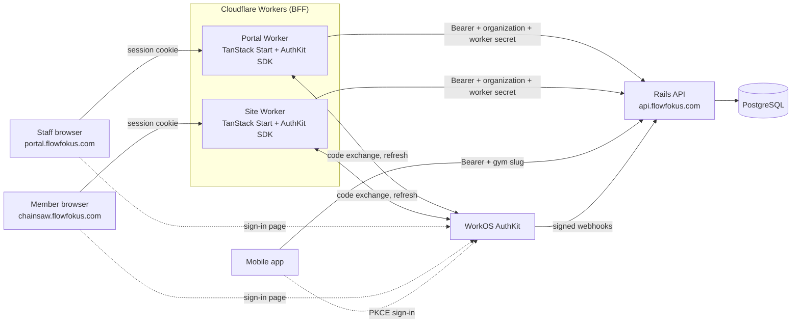
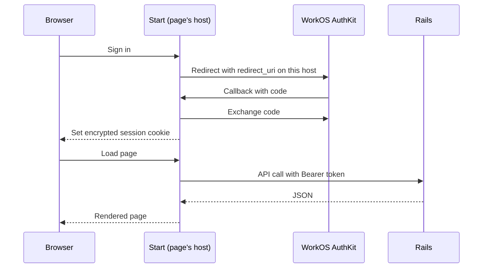
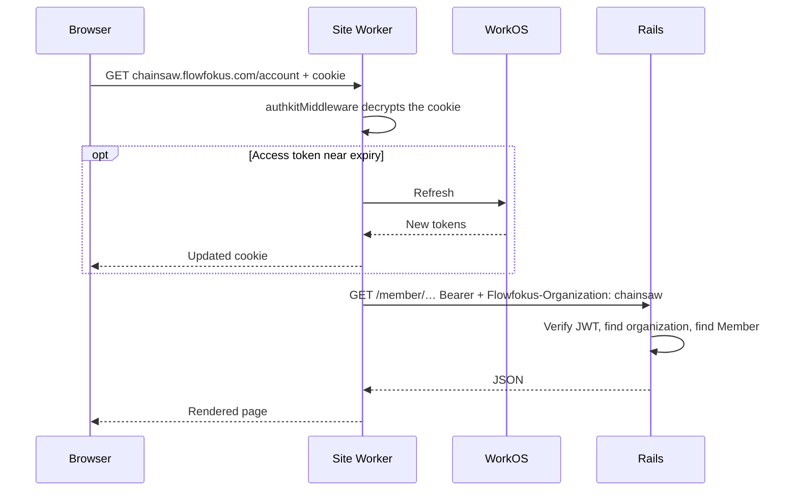
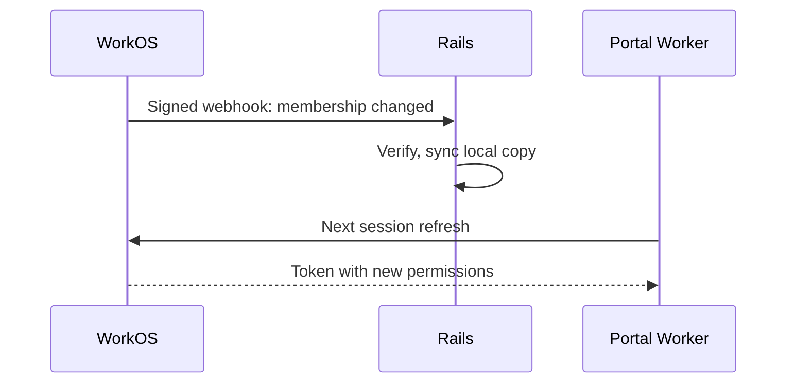

# Authentication

How staff and members sign in. Who they are and what they can access is in [Identity](identity.md) and [Authorization](authorization.md).

## Local development

Staff development uses WorkOS Emulate in Docker with fake users and fixed IDs.
See [Local staff authentication](local-auth.md) for setup and verification.
Plain HTTP development uses the encrypted HttpOnly `hf_session` cookie; HTTPS
uses `__Host-hf_session`. Both are host-only.
The flows below describe the target integration. Member sign-in, live WorkOS
sync, and production deployment still need separate verification.

## Hosts

| Host | App | Users |
| --- | --- | --- |
| `api.flowfokus.com` | Rails API (`apps/server`) | Web app servers, mobile app, WorkOS webhooks |
| `portal.flowfokus.com` | Staff portal (`apps/portal`) | Staff of every organization |
| `<slug>.flowfokus.com`, for example `chainsaw.flowfokus.com` | Gym site (`apps/site`) | The public and members of that organization |
| The organization's own domain, for example `chainsawgym.com`. **Deferred.** | Gym site (`apps/site`) | The public and members of that organization |

Every host points to the same shared infrastructure: one Rails API, one PostgreSQL database, and one build of each web app. A custom domain is only a DNS record that the gym points at Flowfokus's Cloudflare. Gyms run no servers.

## Design: TanStack Start is the BFF

Each web app is a TanStack Start app on Cloudflare Workers. It is the backend for frontend (BFF): it owns the browser session. Rails is an API that accepts Bearer tokens only.



An interactive version with step-by-step flows is in [diagrams/authentication.html](diagrams/authentication.html).

| Link | Credential |
| --- | --- |
| Browser → its Worker | Encrypted `__Host-hf_session` cookie. `HttpOnly`, host-only. Browser JavaScript cannot read it. |
| Worker → Rails | `Authorization: Bearer <WorkOS access token>`, taken from the session on the server. Plus `Flowfokus-Organization`, `Flowfokus-Client-IP`, and `Flowfokus-Worker-Secret`. |
| Worker ↔ WorkOS | API key (Worker secret). Code exchange, refresh, organization switch. |
| Mobile → Rails | `Authorization: Bearer <WorkOS access token>` from secure storage, plus `Flowfokus-Organization` with the chosen gym's slug |
| WorkOS → Rails | Signed webhooks. See [Identity](identity.md#workos-sync). |

Never:

- The browser never sees the access token and never calls Rails.
- Rails never sets cookies.
- Rails never reads host headers. The host never grants access.
- Workers hold no business rules and do not touch the database.

This gives:

- **One cookie per host.** The staff portal and each gym site have separate sessions.
- **No CORS.** The browser talks only to its own origin. Rails is never called from the browser.
- **Signed-in server rendering.** Start reads the session while it renders a page.
- **One credential type in Rails.** Web and mobile both send Bearer tokens. Rails verifies them the same way.

Start handles the session and page delivery only. Rails remains responsible for business data, permissions, and tenant isolation.

## SDK

Use the official WorkOS SDK for TanStack Start: [`@workos/authkit-tanstack-react-start`](https://github.com/workos/authkit-tanstack-start).

| Part | Use |
| --- | --- |
| `authkitMiddleware()` | Validates the session and refreshes it on each request. Register it in `src/start.ts`. |
| `createCsrfMiddleware()` | Required. Registering `authkitMiddleware()` turns off TanStack Start's default CSRF protection. |
| `getAuth()` | Returns the user and access token on the server. |
| `switchToOrganization()` | Refreshes the staff session with another organization's claims. |
| Callback route handler | Completes sign-in on the app's own host. |

Configuration, as Worker variables and secrets:

| Name | Value |
| --- | --- |
| `WORKOS_CLIENT_ID` | Per environment |
| `WORKOS_API_KEY` | Secret |
| `WORKOS_REDIRECT_URI` | The app's default callback URL |
| `WORKOS_COOKIE_PASSWORD` | Secret, at least 32 characters. Encrypts the session cookie. |
| `WORKOS_COOKIE_NAME` | `__Host-hf_session` |

Do not set `WORKOS_COOKIE_DOMAIN`. The cookie must stay host-only.

The SDK states support for Node.js. Confirm that it runs on Workers with `nodejs_compat` before the first release.

## Sign-in flow



1. The user selects **Sign in**. Start redirects to AuthKit with a redirect URI on the current host.
2. AuthKit redirects to `https://<current host>/callback`. Start exchanges the code.
3. Start stores the access and refresh tokens in the encrypted session cookie.
4. On later requests, Start reads the cookie and calls Rails with the access token.

Registered WorkOS redirect URIs:

| URI | Note |
| --- | --- |
| `https://portal.flowfokus.com/callback` | Default. A wildcard cannot be the default. |
| `https://*.flowfokus.com/callback` | All gym sites. WorkOS allows one leftmost wildcard in production. |
| `http://localhost:<portal port>/callback` | Development: staff portal |
| `http://*.localhost:<site port>/callback` | Development: gym sites, for example `chainsaw.localhost` |

The gym site builds its redirect URI from the request host and passes it to `authkitMiddleware({ redirectUri })`. Before it does, it checks that the host is a valid gym host.

## Signed-in request

A member opens the member area on a gym site. Staff requests work the same way through the Portal Worker.



A browser action, such as a purchase, sends JSON to `/api/…` on the same host. The CSRF middleware checks it. The catch-all route adds the Bearer token and forwards it to Rails.

## Sign-out

1. The user selects **Sign out**. The browser sends a `POST` to `/sign-out` on the same host. It is not a `GET`, so other sites cannot sign users out with a link. The CSRF middleware checks it.
2. Start calls the SDK's `signOut()` with a return URL on the same host, for example `https://chainsaw.flowfokus.com/`.
3. The SDK deletes the session cookie and redirects to WorkOS. WorkOS ends the session.
4. WorkOS redirects the browser to the return URL.

Register the return URLs as sign-out redirects in WorkOS: `https://portal.flowfokus.com/`, `https://*.flowfokus.com/`, and the local URLs. Confirm that WorkOS accepts a wildcard here, as it does for redirect URIs.

Whether signing out on one host also ends the user's session on other hosts is an open question. See [Decisions](decisions.md#monorepo-and-release).

## Role changes



Rails uses the permissions in the access token. A changed role takes effect when the Worker next refreshes the session. Until then, the old token stays valid. See the stale sessions question in [Decisions](decisions.md#identity-and-access).

## API areas

The API path names the area. The `Flowfokus-Organization` header names the gym by its slug.

| Path | Area | Called by | Credential |
| --- | --- | --- | --- |
| `/staff/*` | Staff portal | Portal Worker | Bearer token with an organization claim that matches the slug |
| `/member/*` | Member area | Site Worker, mobile app | Bearer token. Rails requires a `Member` in that organization. |
| `/public/*` | Gym site public pages | Site Worker | None |
| `/webhooks/*` | WorkOS sync | WorkOS | Webhook signature |

Where the Worker gets the slug:

- **Site Worker:** from its own host. `chainsaw.flowfokus.com` gives `chainsaw`. Unknown hosts get `404`.
- **Portal Worker:** from the URL. `portal.flowfokus.com/chainsaw/…` gives `chainsaw`.

Each Worker forwards only its own areas. The Site Worker forwards `/member/*` and `/public/*`. The Portal Worker forwards `/staff/*`. A bug or XSS on a gym site then cannot reach staff endpoints, even for a user who is also staff.

## Worker secret and client IP

Rails sees every web request as coming from Cloudflare, not from the user. The Worker adds two headers:

```text
Flowfokus-Client-IP: 203.0.113.7         # the browser's IP, from CF-Connecting-IP
Flowfokus-Worker-Secret: <Worker secret>
```

A Rails middleware checks the secret before the app runs:

```ruby
class WorkerRequest
  def initialize(app) = @app = app

  def call(env)
    request = ActionDispatch::Request.new(env)
    secret  = request.headers["Flowfokus-Worker-Secret"].to_s

    if ActiveSupport::SecurityUtils.secure_compare(secret, ENV.fetch("WORKER_SECRET"))
      env["flowfokus.worker"]    = true
      env["flowfokus.client_ip"] = request.headers["Flowfokus-Client-IP"]
    else
      env["flowfokus.client_ip"] = request.remote_ip
    end

    @app.call(env)
  end
end
```

- With a valid secret, Rails uses `Flowfokus-Client-IP` for rate limits and audit logs.
- Without it, Rails ignores that header and uses the connection's IP. Mobile requests take this path.
- The secret only proves that a request came from our Worker. It never replaces the Bearer token.
- `WORKER_SECRET` is a Worker secret and a Rails environment variable. Rotate it by accepting the old and new values for one deploy.

## Calling Rails

- Server code calls Rails through the typed client in `packages/api`. The base URL is a Worker variable.
- Use one catch-all route, for example `src/routes/api/$.ts`, for calls the browser starts. It adds the Bearer token and forwards the request to Rails. Do not write a server function for every endpoint.
- Start always sets the `Flowfokus-*` headers itself. It never copies them from the browser.
- The access token never reaches the browser. Do not use the SDK's client-side `useAccessToken()`. Never put the token in page data, server function responses, or `localStorage`.
- Start contains no business rules and no database access.

## Staff and members

| | Staff | Member |
| --- | --- | --- |
| Signs in at | `portal.flowfokus.com` | The member area of the gym site |
| WorkOS session | Organization-specific. Carries role and permissions. | User only. Members have no WorkOS membership. |
| Access comes from | Active WorkOS membership and its permissions | A `Member` record in the gym's organization |
| Organization chosen by | The staff member, in the portal URL | The gym site host, or the gym chosen in the mobile app |
| Staff URL | `portal.flowfokus.com/<slug>/…` | — |
| API area | `/staff/*` | `/member/*` |
| `Current` | `user`, `organization`, `permissions` | `user`, `organization`, `member` |

### Staff

1. After sign-in, the portal lists the user's active staff memberships from Rails.
2. If the session already names an organization in that list, open it directly.
   AuthKit can select it during sign-in; the portal must not ask again.
   Otherwise, one membership opens directly and several show an organization selector.
3. To open an organization, Start calls `switchToOrganization()`. The new token carries the role and permissions for that organization.
4. The slug in the URL must match the token's organization. Otherwise Start switches the organization or Rails returns `403`.

### Members

1. The Site Worker sends the slug from its host. Rails finds the organization.
2. Rails finds the `Member` that belongs to both the user and that organization.
3. If there is no such member, the site starts the linking or sign-up flow. Linking requires verified ownership. See [Identity](identity.md#member-customer).

## One person, two roles

Alice is staff at Chainsaw and also a member there.

- She uses `portal.flowfokus.com` as staff and `chainsaw.flowfokus.com` as a member.
- Each host has its own cookie. Both lead to the same WorkOS identity.
- AuthKit remembers her. Signing in on the second host usually needs no password.
- Her member session never grants staff permissions. Her staff session never works on a gym site.

## Mobile

WorkOS supports native apps as a public client with PKCE. The app holds no client secret.

1. The app opens AuthKit with a PKCE challenge.
2. AuthKit redirects back to the app. The app exchanges the code with its verifier.
3. The app keeps tokens in secure storage (Keychain or Keystore).
4. The app calls `api.flowfokus.com/member/…` with `Authorization: Bearer <access token>` and `Flowfokus-Organization` set to the chosen gym's slug.

Mobile is the member area as an app. Rails checks the `Member` record as on the web.

## Rails rules

- Accept Bearer tokens only. Verify each token against the WorkOS JWKS. Rails sets no cookies.
- Decide the audience from the API path, never from the host:
  - `/staff/*`: the token's organization claim must match `Flowfokus-Organization`. Otherwise `403`.
  - `/member/*`: ignore the token's staff permissions. Require a `Member` in that organization.
  - `/public/*`: no token. Return only public data for that organization.
- The slug only chooses which organization to check. It never grants access by itself.
- Trust `Flowfokus-Client-IP` only with a valid Worker secret. See [Worker secret and client IP](#worker-secret-and-client-ip).
- Only Cloudflare may reach the VPS, as defense in depth.

## Security rules

- **Cookie:** `__Host-hf_session`, `HttpOnly`, `Secure`, `SameSite=Lax`, `Path=/`, no `Domain`.
- **CSRF:** `createCsrfMiddleware()` in both apps. Writes accept JSON only.
- **XSS:** Escape all output. Sanitize gym-supplied text and HTML. Use a strict Content Security Policy. Gyms cannot add their own JavaScript.
- **Secrets:** `WORKOS_API_KEY` and `WORKOS_COOKIE_PASSWORD` are Worker secrets. A leaked cookie password lets an attacker forge sessions. Plan how to rotate it.
- **Caching:** Never cache signed-in pages or API responses. Send `Cache-Control: private, no-store`.
- **Refresh races:** WorkOS refresh tokens are single-use. Parallel requests can try to refresh the same token. Refresh before expiry, and retry once with the newest cookie when a refresh fails.
- **Sign-out:** Ends the WorkOS session and deletes the cookie. See [Sign-out](#sign-out). An access token stays valid until it expires. See the stale sessions question in [Decisions](decisions.md#identity-and-access).
- **Reserved slugs:** `api`, `portal`, `www`, `admin`, `auth`, `login`, and similar names cannot be gym slugs.
- **Rate limits:** Cloudflare rate limits on sign-in and on expensive routes.

## Custom domains (deferred)

A custom domain is cross-site to `*.flowfokus.com`, but the design does not change: Start runs on the custom host and sets its own cookie there. Each custom domain needs:

- A Cloudflare custom hostname with a certificate.
- A registered WorkOS redirect URI, added through the WorkOS API when the gym verifies its domain. As an alternative, a central callback with a one-time handoff code.
- A verified `OrganizationDomain`. The Site Worker looks up the slug for the custom host through a public Rails endpoint, and caches the result.
