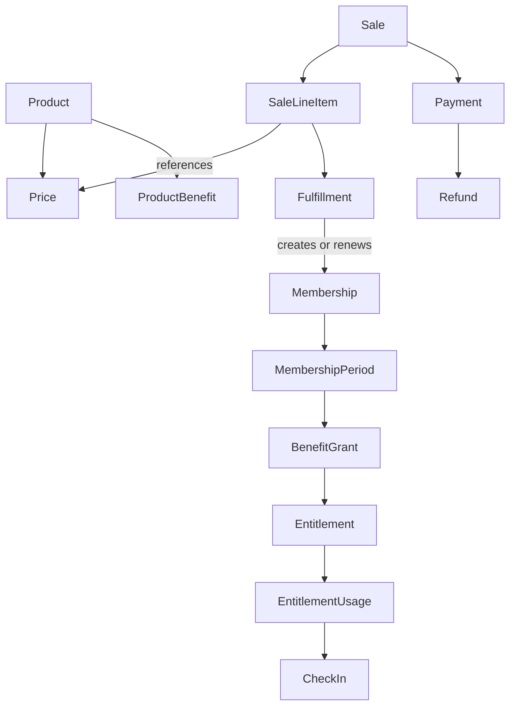

# Benefit Delivery Cycle

Flowfokus's domain has exactly four stages:

**Product → Purchase → Fulfillment → Entitlement**

| Stage | Meaning | Models |
| --- | --- | --- |
| Product | What the business offers. | Product, Price, ProductBenefit |
| Purchase | What the customer bought. | Sale, SaleLineItem, Payment, Refund, Checkout |
| Fulfillment | How Flowfokus delivers it. | Fulfillment, Membership, MembershipPeriod, BenefitGrant |
| Entitlement | What the member can now use. | Entitlement, EntitlementUsage, CheckIn, Booking |

Catalog records grant nothing. A purchase grants nothing until it is fulfilled. Usage belongs to the Entitlement stage; it is not a fifth stage. Bookings are usage too.

Programs and their occurrences sit beside the cycle. They describe what people attend; they are never sold. A ticket is a product made from a program. A booking always uses one entitlement, from a ticket, a pass, or a membership.

The diagram shows relationships, not a full schema. See [Models](models.md) for details.

## Example: monthly membership

| Stage | Example |
| --- | --- |
| Product | Monthly Membership. Price RM120. Benefit: gym access for one month. |
| Purchase | The member buys it. The line item references the RM120 price. Payment completes. |
| Fulfillment | Create the membership, its October period, and a benefit grant. |
| Entitlement | Gym access valid from 1 October 00:00 until 1 November 00:00. Check-ins record use. |

## Example: ten-class pass

| Stage | Example |
| --- | --- |
| Product | 10-Class Pass, kind `pass`. Price RM200 for 60 days. Benefit: ten bookings of any group class. |
| Purchase | Same sale and payment flow, at the desk or online. |
| Fulfillment | Create a benefit grant. No membership is needed. |
| Entitlement | Program access with ten uses. Each booking uses one; cancelling in time returns it. |

## Example: seminar ticket

| Stage | Example |
| --- | --- |
| Product | Deadlift Seminar ticket, kind `ticket`, made from the program. Prices: Early bird RM80, Standard RM120. |
| Purchase | The member picks the 14 November time and pays online. The checkout held the spot. |
| Fulfillment | Create a grant and a one-use right valid until the time ends, then confirm the booking. |
| Entitlement | The booking used the right. Staff mark the member present. |

The same cycle supports all three. Sales and payments need no membership-specific fields.
