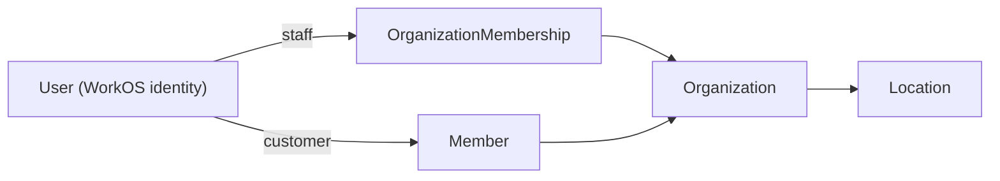

# Identity

Every person has one WorkOS identity. The same person can be staff and a member, in the same organization or in different ones. They never need a second account.



## Models

### User

Local reference to a WorkOS identity. Has many organization memberships and members.

Columns: `workos_id` (unique), `email`, `first_name`, `last_name`.

### Organization

The business tenant. Flowfokus uses `Organization`, not `Account`. Has many locations, members, products, sales, and organization memberships.

Columns: `workos_id` (unique), `name`, `slug` (unique), `timezone`, `currency`.

The slug is also the gym site subdomain: `chainsaw` serves `chainsaw.flowfokus.com`.

### OrganizationDomain (deferred)

Added when custom domains are supported. A custom gym site domain, such as `chainsawgym.com`. Belongs to an organization.

Columns: `organization_id`, `hostname` (unique), `verified_at`.

Only a verified domain serves the gym site or receives a sign-in redirect.

A gym branch is a `Location`, not a separate organization.

### OrganizationMembership (staff)

A user with an active WorkOS membership in an organization is staff. Example roles: Owner, Admin, Manager, Receptionist, Instructor, Viewer.

WorkOS is the authority. Rails keeps a synced copy for reporting, associations, and local reads. Never use the copy to authorize a request.

### Member (customer)

A customer of one organization. Belongs to an organization, and optionally to a user.

Columns: `organization_id`, `user_id` (nullable), `name`, `email`.

- Staff can create a member without a login.
- Link a member to a user only after verified ownership. A matching email is not enough.
- Creating a member never creates a WorkOS membership.

## Staff portal and member area

Users sign in through WorkOS AuthKit. Staff use the staff portal. Members use the member area of their gym site. The gym site's public pages need no sign-in.

| Area | Host | Requires |
| --- | --- | --- |
| Staff portal | `portal.flowfokus.com/<slug>` | A session for that organization, an active WorkOS membership, and the needed permissions. |
| Member area | `<slug>.flowfokus.com/…`; later a verified custom domain and the mobile app | A session and a `Member` in the host's organization linked to the user. |

Staff choose an organization in the staff portal. For members, the host decides the organization. AuthKit remembers the user, so moving between hosts rarely asks for a password. [Authentication](authentication.md) describes the sign-in flow.

Being on a host grants nothing by itself. Rails checks the rules of the area on every API request. The client app is never the authority.

## Request context

```ruby
class Current < ActiveSupport::CurrentAttributes
  attribute :user, :organization, :member, :audience, :permissions
end
```

| Audience | Sets | From |
| --- | --- | --- |
| `:staff` | `user`, `organization`, `permissions` | Verified claims of an organization-specific WorkOS access token. |
| `:member` | `user`, `organization`, `member` | A member that belongs to both the user and the organization. |

The member area never gets staff permissions, even when the person is also staff.

## WorkOS sync

Rails keeps local copies of WorkOS users, organizations, and memberships. WorkOS events or webhooks update them. Reconcile when needed.

Sync processing must be:

- Verified.
- Idempotent.
- Safe with duplicate, delayed, and out-of-order events.
- Observable and recoverable.

Removing staff access never deletes their historical records.
