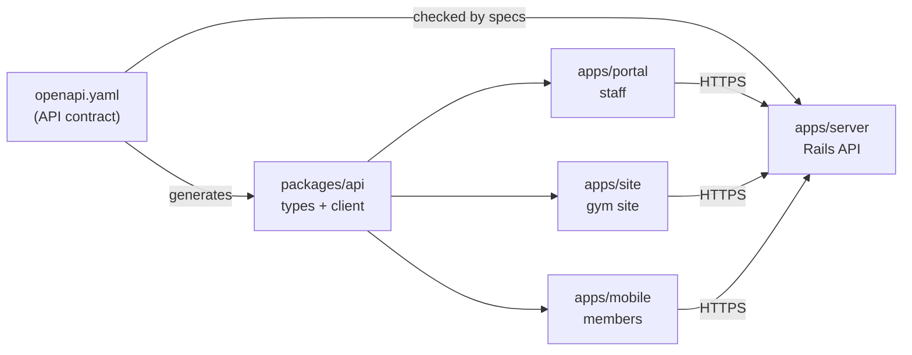

# Monorepo

One repository holds the Rails API and every client app. All apps share one API contract. Each app builds on its own.

This design follows the [monorepo-release-lab](https://github.com/kennedywee/monorepo-release-lab) experiment. Release and deployment are in [Release](release.md).

## Layout

```text
flowfokus/
├── apps/
│   ├── server/     # Rails 8 API. Owns openapi.yaml.
│   ├── portal/     # Staff portal (TanStack Start)
│   ├── site/       # Gym site: public pages, shop, member area (TanStack Start)
│   └── mobile/     # Member app (Expo). Deferred.
├── packages/
│   └── api/        # Generated API types and typed client
├── docs/
├── package.json    # Bun workspace
├── bun.lock
├── mise.toml       # Pinned Ruby, Bun, and Node.js versions
└── mise.lock
```

| App | Users | Stack |
| --- | --- | --- |
| `apps/server` | All clients | Rails 8 API, RSpec |
| `apps/portal` | Staff | TanStack Start (React), TanStack Query, WorkOS AuthKit SDK, Tailwind CSS v4, shadcn/ui on Base UI, on Cloudflare Workers |
| `apps/site` | The public and members | Same as portal |
| `apps/mobile` | Members | Expo (React Native). Deferred with the native app. |

The **gym site** is each organization's member-facing website. It serves public pages, the shop, and a signed-in member area. One build serves every organization; the host decides which one.

Add a shared package only when two apps need the same code. Add a new app (for example, a desktop wrapper or a marketing site) only when there is a need.

JavaScript apps share one Bun workspace. Rails keeps its own `Gemfile`.

## How the apps connect



- Every client calls the same Rails API. Web apps call it from their server code, never from the browser. See [Authentication](authentication.md#calling-rails).
- Clients hold no business rules. Only web app server code holds secrets: the WorkOS API key and the cookie password.
- Client validation only helps users fill forms. Rails validates every write.
- An organization ID sent by a client is not proof of access. Rails resolves the organization and actor on every request. See [Authorization](authorization.md).

## API contract

`apps/server/openapi.yaml` is the single source of API types. Never write API types by hand.

To change the API:

1. Edit `openapi.yaml` and the Rails code in one pull request.
2. Run `bundle exec rspec` in `apps/server`. Specs check real responses against the contract.
3. Run `bun run contract:types`. This regenerates `packages/api`. Commit the result.
4. Run `bun run typecheck`. This checks portal, site, and mobile against the new types.

CI repeats these checks. It also compares the contract with the last stable release. A breaking change, such as removing a field or a path, fails CI. Adding an optional field passes.

What these checks cannot catch:

- Behavior changes that keep the same JSON shape.
- Old mobile versions still in use. The API must stay compatible with them.

## Configuration

- Portal and site read settings from Worker variables and secrets: the Rails URL and the WorkOS settings. The same build works in every environment.
- The browser calls only its own host. Start calls Rails from the server with a Bearer token.
- Mobile calls `api.flowfokus.com`. It compiles this URL into the build. Each environment needs its own mobile build.
- The server reads its settings from environment variables.

## Local development

```sh
mise install       # Ruby, Bun, Node.js from mise.toml
bun install
(cd apps/server && bundle install && bin/rails db:prepare)
```

Run each app in its own terminal:

| App | Command |
| --- | --- |
| server | `cd apps/server && bin/rails server` |
| portal | `bun run --cwd apps/portal dev` |
| site | `bun run --cwd apps/site dev` |
| mobile | `bun run --cwd apps/mobile start` |

In development:

- Portal and site call Rails at `http://127.0.0.1:4000`.
- Open a gym site at `http://<slug>.localhost:<site port>`, for example `chainsaw.localhost:4002`. Browsers send every `*.localhost` name to your machine. No `/etc/hosts` entries are needed.
- Browsers treat `localhost` as secure, so the `__Host-` session cookie works over plain HTTP.
- Each app has its own WorkOS redirect URI in the WorkOS staging environment. See [Authentication](authentication.md#sign-in-flow).

After changing a version in `mise.toml`, run `mise lock` and commit both files.
