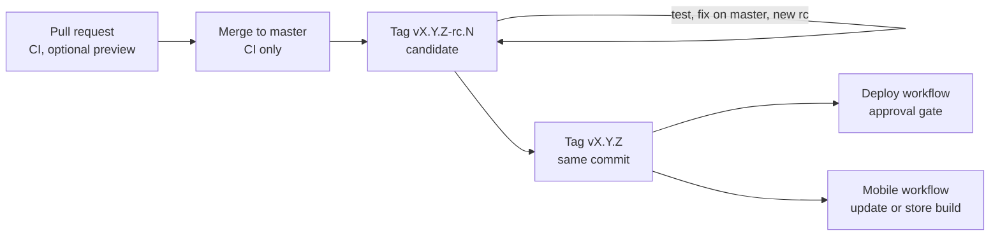

# Release

This is the target release process. Sprint 1 implements CI and candidate artifact packaging. Registry publication and live deployment wait for credentials. See [Deployment candidate](deployment.md).

One Git tag releases every app in the [monorepo](monorepo.md). Building a release never deploys it. A person deploys it later, through an approval gate.

## Flow

| Build | Identified by | Started by | Reaches production? |
| --- | --- | --- | --- |
| PR preview | PR number and commit | `preview` label on a PR | No |
| Release candidate | Tag `vX.Y.Z-rc.N` | A person pushes the tag | No |
| Stable release | Tag `vX.Y.Z` | A person tags the tested candidate commit | Only through Deploy and Mobile |

Merging to `master` runs CI only. It never deploys.

There is no staging environment yet. Production is the only deployed environment. Test release candidates locally and with PR previews.

## Workflows

| Workflow | Trigger | Does |
| --- | --- | --- |
| `ci.yml` | Pull request, push to `master` | Rails specs with contract checks, generated types current, type checks, all app builds, breaking-contract check on PRs. |
| `preview.yml` | PR with the `preview` label | Builds every app from the PR. Uploads portal and site Worker preview versions. No secrets in the build job. |
| `release.yml` | Push of a `v*` tag | Runs CI, builds each app once, publishes the server image, writes the release manifest, creates one GitHub Release. Deploys nothing. |
| `deploy.yml` | Manual: tag, apps | Approval, database backup, migration, server start, smoke test, then web sites. |
| `mobile.yml` | Manual: tag | Sends an EAS Update or submits a store build. |

The **release manifest** records the tag, commit, channel, and each app's build result, checksums, and publication status. If any build fails or is missing, no GitHub Release is created.

## Rules

- **Never move a tag.** Fix on `master` and tag the next `rc`.
- **Promote the same commit.** A stable tag points at the tested candidate commit.
- **Build once, promote the artifact.** Server image and web builds are reused across environments. Only runtime configuration changes. Mobile is the exception: it needs one build per environment.
- **Candidates never reach production.** Deploy and Mobile refuse candidate tags for production.
- **Deploy only what changed.** Choose apps in the Deploy workflow. A change in `packages/api` affects every client. When unsure, deploy all.

## Versions

| Number | Example | Use |
| --- | --- | --- |
| Repository tag | `v1.1.0` | The release of every app. No per-app tags. |
| Mobile store version | `1.1.0` | Tag without `v` and `-rc.N`. Stores reject `-rc`. |
| Mobile build number | `42` | Set by EAS for each store upload. Not a release tag. |
| Mobile runtime version | fingerprint | Decides which installed builds can take an EAS Update. |
| Web `version.json` | `{"tag": "v1.1.0"}` | Shows which release a host serves. |

## Hotfix

Production runs `v1.0.0`. `master` has work that cannot ship yet.

1. Branch from the production tag: `git switch -c hotfix/v1.0.1 v1.0.0`.
2. Fix the bug and run the relevant checks.
3. Tag `v1.0.1` and push the branch and tag. The normal release workflow builds it.
4. Merge the hotfix branch back into `master`.

`v1.0.1` contains `v1.0.0` plus the fix, and none of the newer `master` work.

## Hosting

| App | Runs on | Artifact |
| --- | --- | --- |
| `apps/server` | VPS, as a Docker container | Server image from GHCR |
| PostgreSQL | Reached by the server through `DATABASE_URL` | — |
| `apps/portal` | Cloudflare Worker on `portal.hydraflow.com` | Worker bundle with static assets |
| `apps/site` | Cloudflare Worker on the route `*.hydraflow.com/*` (custom domains later) | Same |

The Workers call Rails at `api.hydraflow.com`. The mobile app and WorkOS webhooks use the same host. Only Cloudflare may reach the VPS. Custom domains, when added, need Cloudflare custom hostnames with certificates.

The `portal.hydraflow.com` route takes precedence over the wildcard route, so the site Worker never serves the portal host. Reserved slugs keep `api`, `portal`, and `www` away from gyms.

Web apps deploy as a new version of each Worker from the released bundle. Only Worker variables and secrets differ per environment. Rollback restores the previous Worker version.

Use the Workers Paid plan in production. The Free plan's daily request cap and per-request CPU limit are too low for server rendering.

## Server deployment

1. Approval by a required reviewer.
2. Pull the image for the tag.
3. Back up the database with `pg_dump`.
4. Run `bin/rails db:migrate` in a one-off container. The server does not migrate on boot.
5. Replace the running server.
6. Smoke test `/up` and one API endpoint.
7. Deploy portal and site Workers with the environment's variables.

Rollback: start the previous image and restore the previous Worker versions. A migration that changed data cannot be undone this way; restore the backup.

Keep migrations backward compatible. Add first, remove in a later release. Old mobile apps and the previous server may still run against the new schema.

### Manual data preparation

When a migration can fail on existing production rows (for example, a new check constraint):

1. **Inspect** production with a read-only script.
2. **Decide** per finding: permit, repair, or block.
3. **Repair** approved rows in one transaction. Save the output. A repair is not a migration.
4. **Verify** again, and once more right before deployment.
5. **Approve** the deploy with a link to the record.

A candidate database cannot prove that production is ready. Only an inspection on production can.

## Mobile delivery

| Change | Ships as |
| --- | --- |
| TypeScript only: screens, text, API calls, fixes | EAS Update to installed builds with the same runtime version |
| Native: modules, SDK upgrade, permissions, icons, native config | New EAS build and store submission |

Submitting is not releasing. A person releases the build in the store, often as a staged rollout. Users update over weeks; some never do. The API must keep working for older versions.
